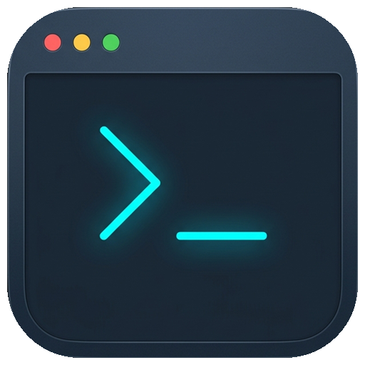
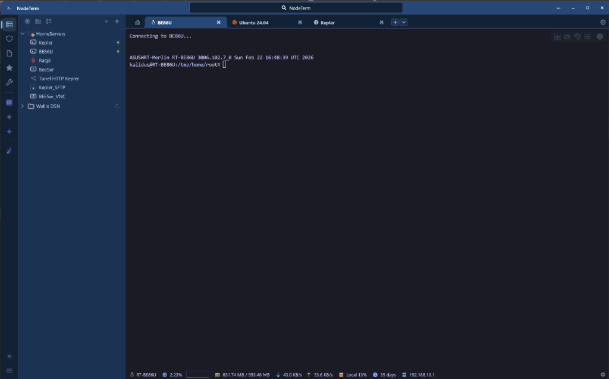

<div align="center">

  

  # 🚀 NodeTerm

  <b>Un cliente de acceso remoto "all-in-one" moderno, multiprotocolo, con bóveda de contraseñas y automatización para agentes de IA (MCP) en un espacio multipestaña ultrarrápido.</b>

  <p align="center">
    <a href="README.md"></a>
    <a href="docs/README.en.md"></a>
  </p>

  <p align="center">
    <a href="https://github.com/kalidus/NodeTerm/releases"></a>
    <a href="https://github.com/kalidus/NodeTerm/releases"></a>
    <a href="#-servidor-mcp-integrado-model-context-protocol"></a>
    <a href="https://github.com/kalidus/NodeTerm/releases"></a>
    <a href="https://github.com/kalidus/NodeTerm/stargazers"></a>
    <a href="LICENSE"></a>
    <a href="#donar"></a>
  </p>

  <p align="center">
    <a href="https://github.com/kalidus/NodeTerm/releases/latest">
      
    </a>
    &nbsp;
    <a href="https://kalidus.github.io/NodeTerm/">
      
    </a>
    &nbsp;
    <a href="#-instalación-rápida">
      
    </a>
  </p>

  

</div>

---

## ✨ Características Destacadas

NodeTerm es un espacio de trabajo remoto *all-in-one* que unifica múltiples protocolos de conexión, una bóveda cifrada de credenciales y capacidades avanzadas de automatización con IA en una interfaz moderna y ultrarrápida.

### 🌐 1. Conexión & Soporte Multiprotocolo
- 🖥️ **Multiprotocolo Completo**: Soporte nativo para **SSH**, **RDP** (IronRDP por defecto, Wallix/CyberArk), **VNC** (cliente noVNC) y **SFTP**.
- 🛡️ **Gestión SSH Profesional**: Conexión a bastiones Wallix, autenticación por clave/contraseña y pool de conexiones optimizado.
- 🗂️ **Espacio de Trabajo Multipestaña**: Organización jerárquica de sesiones en carpetas y agrupación de pestañas por proyectos.
- 📁 **Explorador SFTP Integrado**: Navegación remota visual, operaciones de archivos (copiar, pegar, eliminar) y búsqueda inteligente.

### 🤖 2. Ecosistema de IA Avanzado (Servidor MCP Integrado)
- 🔌 **Servidor MCP Nativo**: Protocolo estándar (Model Context Protocol) para conectar agentes de IA externos (Claude, Cursor, Antigravity, AnythingLLM).
- 🛡️ **Seguridad & Prompt Ticket**: Inyección segura de secretos y credenciales (`promptTicket`) sin exponer contraseñas al agente de IA.
- 📑 **Acceso a Recursos**: Los agentes de IA pueden consultar y gestionar de forma autorizada conexiones, notas, documentos y terminales abiertos.

### 🔒 3. Seguridad & Bóveda de Credenciales (Vault)
- 🛡️ **Encriptación AES-256**: NodeTerm incluye un sistema completo de encriptación AES-256 para proteger todas las credenciales y datos sensibles almacenados localmente.
- 🔑 **Master Password & Auto-Lock**: Clave única para desbloquear la aplicación con temporizador de bloqueo automático.
- 📹 **Sistema de Auditoría y Grabación**: Incluye un sistema completo de grabación y auditoría de sesiones SSH para compliance, debugging y documentación:

### ⚡ 4. Productividad, Splits & Red Remota
- 🖥️ **Splits a 60 FPS**: Motor `xterm.js` con división de pantalla horizontal y vertical, redimensionamiento fluido y menús contextuales.
- 🔌 **Túneles SSH Avanzados**: Túneles Locales (`-L`), Remotos (`-R`) y Proxy SOCKS5 Dinámico (`-D`) con verificación automática de puertos libres y limpieza de puertos huérfanos.
- 📹 **Auditoría & Grabación asciinema**: Captura toda la entrada/salida de sesiones SSH en formato estándar `asciicast v2` (.cast) con reproductor integrado.
- 🚀 **Arranque Ultra-Rápido**: Carga diferida inteligente (*Lazy Loading*) de módulos y servicios pesados.

### 📊 5. Monitoreo del Sistema & Diagnóstico
- 📈 **Telemetría en Tiempo Real**: Métricas de CPU, memoria RAM y carga del sistema en tiempo real con gráficas de histórico.
- 🐧 **Auto-detección OS**: Detección automática de distribuciones Linux e indicadores visuales de estado de conexión.

### 🎨 6. Personalización Total & UX
- 🏠 **Dashboard HomeTab**: paneles flotantes, widgets, recientes/favoritos y novedades de cada release.
- 🎨 **Temas de UI y Terminal**: temas oscuros/claros, marcos holograficos/cyberpunk y selector de tipografia 8-32.
- 🔤 **Fuentes & Iconos**: Soporte para fuentes especializadas con ligaduras (*FiraCode*, *JetBrains Mono*) y packs de iconos (*Material*, *VSCode*).
- ⌨️ **Atajos & Layout**: Configuración completa de teclado, pestañas organizables por proyectos y menús contextuales avanzados.
- 🔄 **Actualizador Automático**: Comprobación en segundo plano desde GitHub Releases con canales Estable y Beta.

---

## 🚀 Instalación Rápida

### Desktop (Electron)
```sh
# Descarga el instalador ejecutable (.exe / .AppImage / .deb / pacman)
https://github.com/kalidus/NodeTerm/releases
```

<details>
<summary>🛠️ <strong>Desarrollo local</strong></summary>

```sh
# Clonar el repositorio
git clone https://github.com/kalidus/NodeTerm.git
cd NodeTerm

# Node.js 24 LTS recomendado (nvm: nvm install && nvm use)
# Linux (Arch/CachyOS): sudo pacman -S --needed base-devel python

# Instalar dependencias (sin sudo)
npm install

# Modo desarrollo
npm run dev

# Construir ejecutable
npm run build:win
```

En Linux, `npm install` ejecuta automáticamente la reparación del binario de Electron si la instalación quedó incompleta. No uses `sudo npm install` dentro del proyecto.

</details>

---

## 📦 Versión y Novedades

[](https://github.com/kalidus/NodeTerm/releases/latest)
[](CHANGELOG.md)

Descargas e instaladores en **[GitHub Releases](https://github.com/kalidus/NodeTerm/releases)** · Historial completo en **[CHANGELOG.md](CHANGELOG.md)**.

---

## 🏗️ Arquitectura Técnica

<details>
<summary>🛠️ <strong>Stack y estructura</strong></summary>

**Stack Tecnológico**
```
Frontend:  React 19 + PrimeReact + Lucide / React Icons
Backend:   Electron 40 + Node.js 24 LTS
SSH/SFTP:  ssh2 + ssh2-promise
RDP / VNC: IronRDP (WASM / Rust) + noVNC
Terminal:  xterm.js 6.x + WebGL addon
Build:     Webpack 5 + Babel
```

**Estructura del Proyecto**
```
NodeTerm/
├── 📁 src/
│   ├── 📁 components/     # Componentes de UI (Tabs, Modales, HomeTab)
│   ├── 📁 services/       # Conexiones SSH, SFTP, IronRDP, VNC y Vault
│   ├── 📁 hooks/          # Hooks React de gestión de estado y terminales
│   └── 📁 assets/         # Estilos y recursos gráficos
├── 📁 mcp/                # Servidor nativo Model Context Protocol
├── 📄 main.js             # Proceso principal de Electron (IPC / Windowing)
└── 📄 preload.js          # Preload bridge seguro (Context Isolation)
```

</details>

---

## 🗓️ Roadmap

```
  ✅ v1.7 (Consolidado)          🎯 En Curso                     🔮 Futuro (v1.8+)
 ─────────────────────────      ─────────────────────────       ─────────────────────────
 • IronRDP WASM & VNC nativo    • Rendimiento e IPC continuo    • Mux & Atelier avanzados
 • Hardening Vault & Secretos   • Mejoras en Quick Panel        • Nuevas tools y skills MCP
 • Servidor nativo MCP          • Carga cold/warm optimizada    • Integración multi-shell
 • HomeTab & Quick Studio
```

> ¿Tienes ideas o sugerencias? Participa en las discusiones y votaciones en [GitHub Discussions](https://github.com/kalidus/NodeTerm/discussions).

---

<a id="donar"></a>
## 💖 Apoyar el Proyecto

NodeTerm es un proyecto independiente de código abierto creado para la comunidad. Si te resulta útil en tu día a día como sysadmin, desarrollador o entusiasta de la infraestructura, cualquier muestra de apoyo es bienvenida:

- ⭐ **Deja una estrella en GitHub**: Ayuda a dar visibilidad al proyecto.
- 💬 **Comparte tu experiencia**: Sugiere ideas, reporta fallos o recomienda la herramienta a tu equipo.
- ☕ **Invita a un café o dona**: Si deseas apoyar económicamente el tiempo dedicado al desarrollo.

<br/>

<p align="left" style="display: flex; align-items: center; flex-wrap: wrap; gap: 8px;">
  <a href="https://github.com/sponsors/kalidus"></a>
  <a href="https://paypal.me/k4lidus"></a>
  <a href="https://ko-fi.com/kalidus"></a>
  <a href="https://buymeacoffee.com/kalidus"></a>
</p>

<table style="border: none; border-collapse: collapse; background: transparent;">
  <tr style="border: none; background: transparent;">
    <td style="border: none; padding: 0 16px 0 0; vertical-align: top;">
      <details>
        <summary style="list-style: none; cursor: pointer; display: inline-flex; align-items: center;">
          
          
        </summary>
        <br/>
        <table>
          <tr>
            <th align="center">Ethereum / EVM (ETH, Polygon, Arbitrum, BSC)</th>
          </tr>
          <tr>
            <td align="center">
              <br/>
              <sub>Escanea con MetaMask / Rabby / Trust</sub>
            </td>
          </tr>
          <tr>
            <td align="center"><code>0x7D18e60b2717edA94e6a48d05e6d09038dCf9342</code></td>
          </tr>
        </table>
      </details>
    </td>
    <td style="border: none; padding: 0; vertical-align: top;">
      <details>
        <summary style="list-style: none; cursor: pointer; display: inline-flex; align-items: center;">
          
          
        </summary>
        <br/>
        <table>
          <tr>
            <th align="center">Solana (SOL, USDC)</th>
          </tr>
          <tr>
            <td align="center">
              <br/>
              <sub>Escanea con Phantom / Solflare</sub>
            </td>
          </tr>
          <tr>
            <td align="center"><code>DAP3efj9Fvp1uvf8eVse3dMTxxyw2bWLh4snA891iNZh</code></td>
          </tr>
        </table>
      </details>
    </td>
  </tr>
</table>

¡Muchas gracias a toda la comunidad por hacer posible NodeTerm! 🙏

---

## 🤝 Contribuciones

¡Las contribuciones son bienvenidas! Si quieres ayudar a mejorar NodeTerm:

1. 🍴 **Fork** el repositorio
2. 🌿 Crea una **rama** para tu feature (`git checkout -b feature/nueva-funcionalidad`)
3. 💾 **Commit** tus cambios (`git commit -m 'feat: añadir nueva funcionalidad'`)
4. 📤 **Push** a la rama (`git push origin feature/nueva-funcionalidad`)
5. 🔄 Abre un **Pull Request**

### 🐛 Reportar Bugs
- Abre un [Bug report](https://github.com/kalidus/NodeTerm/issues/new?template=bug_report.yml)
- Incluye sistema operativo, version de NodeTerm y pasos para reproducir

### 💡 Solicitar Funcionalidades
- Idea abierta o votacion: [Discussions / Ideas](https://github.com/kalidus/NodeTerm/discussions/new?category=ideas)
- Peticion concreta para implementar: [Feature request](https://github.com/kalidus/NodeTerm/issues/new?template=feature_request.yml)

### Preguntas
- Dudas de uso: [Discussions / Q&A](https://github.com/kalidus/NodeTerm/discussions/new?category=q-a)

---

## 🤖 Sobre el Desarrollo

**NodeTerm** es un proyecto innovador desarrollado utilizando **IA avanzada** en colaboración humano-máquina. Lo que comenzó como un ejercicio de **vibe coding** se ha transformado en una herramienta profesional y moderna, específicamente diseñada para **administradores de infraestructuras** que necesitan una solución SSH robusta y eficiente.

Las PRs y sugerencias son bienvenidas. Usa Issues y Discussions segun el tipo de peticion.

---

## 📄 Licencia

GPL-3.0. Licencia comercial: ver [LICENSE-COMMERCIAL.md](docs/legal/LICENSE-COMMERCIAL.md). Versiones 1.7.6 e inferiores siguen en ISC. Hecho por [kalidus](https://github.com/kalidus).
