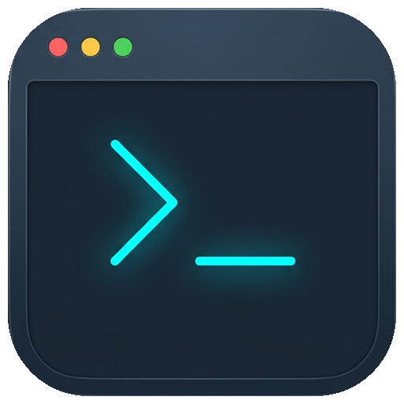
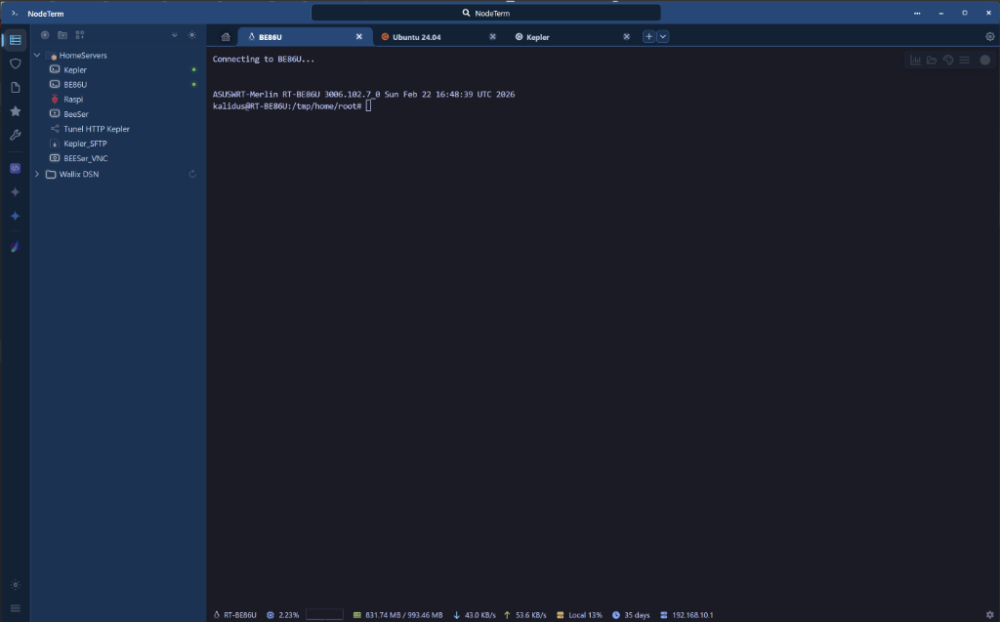

<div align="center">

  

  # 🚀 NodeTerm

  <b>A modern, multi-protocol "all-in-one" remote access client with built-in password vault and AI integration in an ultra-fast multi-tab workspace.</b>

  <p align="center">
    <a href="../README.md"></a>
    <a href="README.en.md"></a>
  </p>

  <p align="center">
    <a href="https://github.com/kalidus/NodeTerm/releases"></a>
    <a href="https://github.com/kalidus/NodeTerm/releases"></a>
    <a href="#-advanced-ai-ecosystem-integrated-mcp-server"></a>
    <a href="https://github.com/kalidus/NodeTerm/releases"></a>
    <a href="https://github.com/kalidus/NodeTerm/stargazers"></a>
    <a href="../LICENSE"></a>
    <a href="#donate"></a>
  </p>

  <p align="center">
    <a href="https://github.com/kalidus/NodeTerm/releases/latest">
      
    </a>
    &nbsp;
    <a href="https://kalidus.github.io/NodeTerm/">
      
    </a>
    &nbsp;
    <a href="#-quick-installation">
      
    </a>
  </p>

  

</div>

---

## ✨ Highlight Features

NodeTerm is an *all-in-one* remote workspace that unifies multiple connection protocols, an encrypted credential vault, and advanced AI automation capabilities within a modern, ultra-fast interface.

### 🌐 1. Connection & Multi-Protocol Support
- 🖥️ **Full Multi-Protocol**: Native **SSH**, **RDP** (IronRDP default, Wallix/CyberArk), **VNC** (noVNC client), and **SFTP**.
- 🛡️ **Professional SSH Management**: Wallix bastion integration, key/password authentication, and optimized connection pooling.
- 🗂️ **Multi-Tab Workspace**: Hierarchical session organization in folders and tab grouping by projects.
- 📁 **Integrated SFTP Explorer**: Visual remote navigation, file operations (copy, paste, delete), and smart search.

### 🤖 2. Advanced AI Ecosystem (Integrated MCP Server)
- 🔌 **Native MCP Server**: Standard Model Context Protocol to connect external AI agents (Claude, Cursor, Antigravity, AnythingLLM).
- 🛡️ **Security & Prompt Ticket**: Secure secret and credential injection (`promptTicket`) without exposing passwords to the AI agent.
- 📑 **Resource Access**: Authorized AI agents can query and manage connections, notes, documents, and active terminals.

### 🔒 3. Security & Credential Vault
- 🛡️ **AES-256 Encryption**: NodeTerm features full AES-256 encryption to protect all credentials and sensitive data stored locally.
- 🔑 **Master Password & Auto-Lock**: Single master password to unlock the app with configurable auto-lock timer.
- 📹 **Audit & Session Recording**: Built-in SSH session audit and recording system for compliance, debugging, and documentation.

### ⚡ 4. Productivity, Splits & Remote Tunneling
- 🖥️ **60 FPS Splits**: Powered by `xterm.js` with horizontal/vertical screen split, smooth resizing, and context menus.
- 🔌 **Advanced SSH Tunnels**: Local (`-L`), Remote (`-R`), and Dynamic SOCKS5 Proxy (`-D`) tunnels with automatic free port detection and orphan cleanup.
- 📹 **asciinema Audit & Recording**: Capture all SSH input/output in standard `asciicast v2` (.cast) format with built-in player.
- 🚀 **Ultra-Fast Boot**: Intelligent lazy loading of heavy modules and background services.

### 📊 5. System Monitoring & Diagnostics
- 📈 **Real-Time Telemetry**: Real-time CPU, RAM, and system load metrics with historical graphs.
- 🐧 **OS Auto-Detection**: Automatic Linux distro detection and visual connection status indicators.

### 🎨 6. Total Customization & UX
- 🏠 **HomeTab dashboard**: floating panels, widgets, recents/favorites, and in-app release notes.
- 🎨 **UI & Terminal Themes**: dark/light themes, holographic/cyberpunk frames, and 8-32 font size control.
- 🔤 **Fonts & Icons**: Support for developer fonts with ligatures (*FiraCode*, *JetBrains Mono*) and icon packs (*Material*, *VSCode*).
- ⌨️ **Shortcuts & Layout**: Full keyboard customization, project-grouped tabs, and rich context menus.
- 🔄 **Auto-Updater**: Background update checker via GitHub Releases with Stable and Beta channels.

---

## 🚀 Quick Installation

### Desktop (Electron)
```sh
# Download the executable installer (.exe / .AppImage / .deb / pacman)
https://github.com/kalidus/NodeTerm/releases
```

<details>
<summary>🛠️ <strong>Local Development</strong></summary>

```sh
# Clone repository
git clone https://github.com/kalidus/NodeTerm.git
cd NodeTerm

# Node.js 24 LTS recommended (nvm: nvm install && nvm use)
# Linux (Arch/CachyOS): sudo pacman -S --needed base-devel python

# Install dependencies (without sudo)
npm install

# Development mode
npm run dev

# Build binary
npm run build:win
```

On Linux, `npm install` automatically repairs the Electron binary if the download was interrupted. Do not run `sudo npm install`.

</details>

---

## 📦 Version & Releases

[](https://github.com/kalidus/NodeTerm/releases/latest)
[](../CHANGELOG.md)

Download installers in **[GitHub Releases](https://github.com/kalidus/NodeTerm/releases)** · Full history in **[CHANGELOG.md](../CHANGELOG.md)**.

---

## 🏗️ Technical Architecture

<details>
<summary>🛠️ <strong>Stack & Structure</strong></summary>

**Tech Stack**
```
Frontend:  React 19 + PrimeReact + Lucide / React Icons
Backend:   Electron 40 + Node.js 24 LTS
SSH/SFTP:  ssh2 + ssh2-promise
RDP / VNC: IronRDP (WASM / Rust) + noVNC
Terminal:  xterm.js 6.x + WebGL addon
Build:     Webpack 5 + Babel
```

**Project Structure**
```
NodeTerm/
├── 📁 src/
│   ├── 📁 components/     # UI components (Tabs, Modals, HomeTab)
│   ├── 📁 services/       # SSH, SFTP, IronRDP, VNC and Vault services
│   ├── 📁 hooks/          # React hooks for state and terminal management
│   └── 📁 assets/         # Styles and graphic assets
├── 📁 mcp/                # Native Model Context Protocol server
├── 📄 main.js             # Electron main process (IPC / Windowing)
└── 📄 preload.js          # Secure preload bridge (Context Isolation)
```

</details>

---

## 🗓️ Roadmap

```
  ✅ v1.7 (Consolidated)         🎯 In Progress                  🔮 Future (v1.8+)
 ─────────────────────────      ─────────────────────────       ─────────────────────────
 • IronRDP WASM & Native VNC    • Continuous IPC & perf tuning  • Advanced Mux & Atelier
 • Vault & Secrets hardening    • Quick Appearance Panel polish • New MCP tools & skills
 • Native MCP server            • Cold/warm start optimization  • Multi-shell integration
 • HomeTab & Quick Studio
```

> Have ideas or suggestions? Join the roadmap discussions on [GitHub Discussions](https://github.com/kalidus/NodeTerm/discussions).

---

<a id="donate"></a>
## 💖 Support the Project

NodeTerm is an independent open-source project built for the community. If it makes your day-to-day work easier as a sysadmin, developer, or infrastructure enthusiast, any kind of support is warmly welcome:

- ⭐ **Star the repo on GitHub**: Helps increase project visibility.
- 💬 **Share your feedback**: Propose ideas, report bugs, or recommend NodeTerm to your team.
- ☕ **Buy me a coffee or donate**: If you'd like to financially support the time spent on development.

<br/>

<p align="left">
  <a href="https://github.com/sponsors/kalidus"></a>
  &nbsp;
  <a href="https://ko-fi.com/kalidus"></a>
  &nbsp;
  <a href="https://buymeacoffee.com/kalidus"></a>
  &nbsp;
  <a href="https://etherscan.io/address/0x7D18e60b2717edA94e6a48d05e6d09038dCf9342"></a>
  &nbsp;
  <a href="https://solscan.io/account/DAP3efj9Fvp1uvf8eVse3dMTxxyw2bWLh4snA891iNZh"></a>
</p>

Thank you so much to everyone supporting NodeTerm! 🙏

---

## 🤝 Contributions

Contributions are welcome! If you'd like to improve NodeTerm:

1. 🍴 **Fork** the repository
2. 🌿 Create a **branch** for your feature (`git checkout -b feature/new-feature`)
3. 💾 **Commit** your changes (`git commit -m 'feat: add new feature'`)
4. 📤 **Push** to the branch (`git push origin feature/new-feature`)
5. 🔄 Open a **Pull Request**

---

## 🤖 About the Development

**NodeTerm** is an innovative project developed using **advanced AI** in human-machine collaboration. What started as a **vibe coding** experiment has evolved into a professional tool specifically designed for **infrastructure administrators** who need a robust SSH solution.

---

## 📄 License

GPL-3.0. Commercial licensing: see [LICENSE-COMMERCIAL.md](legal/LICENSE-COMMERCIAL.md). Versions 1.7.6 and earlier remain under ISC. Made by [kalidus](https://github.com/kalidus).
